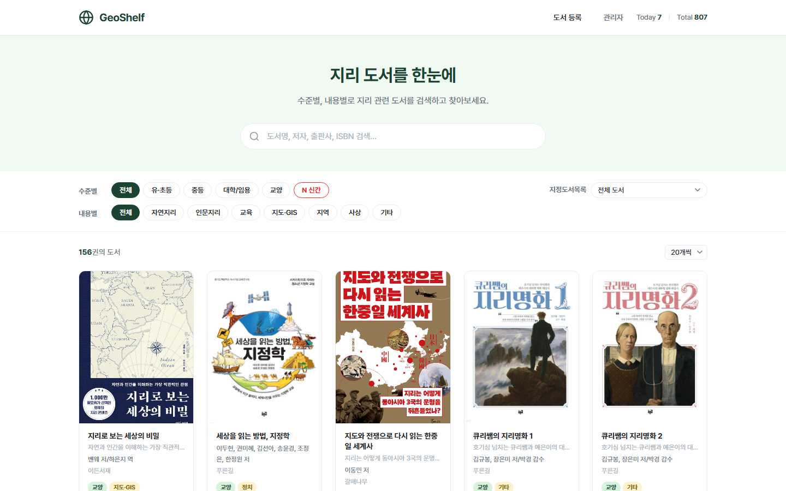

# GeoShelf (지오셸프)

지리 관련 도서를 수준별, 내용별로 모아 찾아보는 웹사이트입니다. 학생, 교사, 임용 준비생이 읽을 만한 지리 책을 한눈에 살피고, 서점 링크로 바로 넘어갈 수 있습니다. 누구나 책을 추천해 등록 신청을 할 수 있고, 관리자가 승인하면 목록에 올라갑니다.

- 바로가기: https://geoshelf.kr



## 할 수 있는 일

- **검색**: 도서명, 부제, 저자, 출판사, ISBN으로 찾습니다.
- **수준별 거르기**: 유아와 초등, 중등, 대학/임용, 교양, 그리고 출판 90일 안의 신간.
- **내용별 거르기**: 자연지리(기후, 지형), 인문지리(문화, 역사, 도시, 촌락, 인구, 경제, 정치), 교육, 지도와 GIS, 지역, 사상, 기타.
- **지정 도서 목록**: 특정 목록(예: 읽기 활동 목록)에 든 책만 모아 봅니다. 책 한 권은 목록 다섯 개까지 들어갈 수 있습니다.
- **목록 보기**: 출판일 최신순(같으면 제목 가나다순)으로 10, 20, 50권씩 나눠 봅니다. 책을 누르면 자세한 정보와 교보문고, Yes24, 알라딘 링크가 나옵니다.
- **도서 등록 신청**(`register.html`): 표지 그림 주소, ISBN-13(검사함), 구매 링크, 분류를 넣어 신청합니다. 신청하면 관리자에게 알림 메일이 갑니다.
- **관리자 화면**(`admin.html`): 승인 대기 도서를 승인하거나 거절하고, 등록된 도서를 고치거나 지웁니다(지운 책은 휴지통 시트로).
- **방문자 수**: 오늘과 전체 방문자 수를 위쪽에 보여 줍니다.

## 구조

화면은 HTML, CSS, 바닐라 JavaScript로 된 정적 사이트입니다. 자료는 구글 스프레드시트에 있고, Google Apps Script 웹 앱이 읽기, 등록, 승인, 수정, 삭제, 방문자 수 세기를 맡습니다.

| 시트 | 내용 |
|---|---|
| 도서목록 | 공개된 도서 |
| 대기목록 | 승인 대기 중인 신청 |
| 휴지통 | 지운 도서 |
| 조회수 | 날짜별 방문자 수 |

## 실행하기

빌드가 없습니다. 아무 정적 서버로 엽니다.

```bash
python -m http.server 8000     # http://localhost:8000
```

`js/config.js`의 `API_URL`을 비우면 예시 도서로 동작하는 데모 모드가 됩니다.

### 백엔드 만들기

1. 구글 스프레드시트를 새로 만들고 [확장 프로그램] > [Apps Script]를 엽니다.
2. `apps-script/Code.gs`를 붙여 넣고, `CONFIG`에 스프레드시트 ID, 관리자 비밀번호, 알림 받을 이메일을 넣습니다.
3. `setup()`을 한 번 실행해 시트를 만듭니다.
4. [배포] > [새 배포] > 웹 앱(실행 사용자: 나, 액세스: 모든 사용자)으로 배포합니다.
5. 배포 주소를 `js/config.js`의 `API_URL`에 넣습니다.

처음 자료를 한꺼번에 넣을 때는 `data/geobooks_import.csv` 형식을 참고합니다.

배포는 Vercel(geoshelf.kr)입니다.

## 파일 구성

```
index.html             도서 목록
register.html          도서 등록 신청
admin.html             관리자 화면
css/style.css
js/
  config.js            Apps Script 주소, 데모용 예시 도서
  app.js               목록, 검색, 거르기, 자세히 보기, 방문자 수
  register.js          등록 신청 양식
  admin.js             승인, 거절, 수정, 삭제
apps-script/Code.gs    구글 시트 백엔드
data/geobooks_import.csv   처음 넣은 도서 자료
vercel.json, CNAME     배포 설정
```

## 만든 사람

양정고등학교 지리교사 김용현  
문의: bgnlkim@gmail.com
